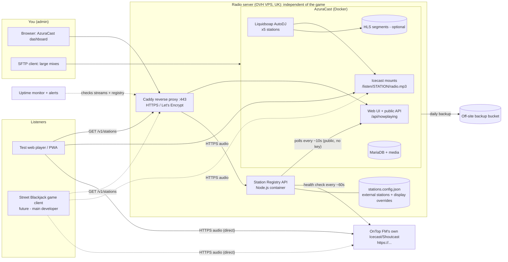

# Street Blackjack Radio: Stage 1 Findings

**Date:** 16 October 2026
**Scope:** Investigation only. Nothing has been built yet.
**Sources:** Current AzuraCast documentation and provider pricing pages, checked October 2026 (full list at the end). Where a source was third-party or a figure could not be confirmed, it is marked **(verify)**.

---

## 0. Summary

- **AzuraCast covers most of the brief out of the box:** 24/7 stations, AutoDJ, playlists, scheduling, looping, the admin dashboard, listener counts, interval adverts, backups, HTTPS, and optional HLS. We configure it; we don't rebuild it.
- **Custom work is limited to three small pieces:** the Station Registry API, the test web player, and (optionally) tooling to put adverts *inside* long mixes.
- **OnTop FM should not go through AzuraCast.** The player connects straight to its stream. The one exception is if that stream is HTTP-only (see §5).
- **Recommended host: an OVHcloud VPS in the UK**, about **£9–17/month ex VAT** including unmetered traffic. On metered providers, bandwidth is the main cost from a few hundred listeners up, and at 5,000 listeners it runs to hundreds or thousands of pounds a month. **Hetzner (Germany/Finland)** is the EU alternative.
- **Two iPhone facts shape the player design:**
  1. iOS Safari **does not let web pages set audio volume**. `audio.volume` is ignored, so the volume slider only works on desktop and Android.
  2. Background and lock-screen playback works with a plain `<audio>` element plus the Media Session API. It still has to be confirmed on a real device as a home-screen PWA.
- **Biggest non-technical risk: music licensing.** PPL's Linear Webcast Licence has exclusions that matter here (closed or password-protected services, a single advertiser, loops under 3 hours, and listener pause/skip). Check this before launch (§7).

---

## 1. Requirements: what AzuraCast does natively

Key: **Native** = works out of the box · **Config** = native, but needs setting up · **Custom** = we build it

### 1.1 Broadcasting and stations

| # | Requirement | Status | Notes |
|---|---|---|---|
| 1 | Multiple independent stations | **Native** | Each station has its own Liquidsoap (AutoDJ) and Icecast mount. The docs say the recommended spec suits "hobby usage (5 to 10 stations)". |
| 2 | 24/7 broadcasting with or without listeners | **Native** | AutoDJ runs constantly and doesn't care whether anyone is connected. Stage 2 will include a script that proves this. |
| 3 | Listeners join the live position, not the start of the mix | **Native** | This is how an Icecast broadcast stream works. A new listener receives the current audio, and nothing is on-demand. |
| 4 | Next mix plays automatically, and playlists loop | **Native** | General-rotation playlists loop forever. Playback order can be sequential, shuffled or random. |
| 5 | Five genre stations | **Config** | One AzuraCast station per genre. |
| 6 | Easy to add stations later | **Native + Custom** | Create the station in AzuraCast and the registry picks it up automatically, with no player or game changes. External stations go in a registry config file. |
| 7 | Fallback if a playlist is empty or broken | **Config** | Set a per-station custom fallback file (a "we'll be right back" loop) so the stream never goes silent. |
| 8 | Auto-recovery after Liquidsoap/Icecast restarts | **Native + Config** | Processes are supervised and restarted. Set the Docker restart policy, and add uptime monitoring and alerts. |

### 1.2 Admin dashboard (your section 3)

| Requirement | Status | Notes |
|---|---|---|
| Upload long DJ mixes | **Native** | Web uploader in the media manager. For very large files (multi-GB WAVs) use the built-in per-station **SFTP**. |
| Create, manage, disable or remove stations | **Native** | System Administration → Stations. Stations can be disabled without being deleted. |
| Assign music to genres | **Config** | The station is the genre. Inside a station, use folders and playlists for sub-genres (for example Drill and Grime). |
| Create playlists and set playback order | **Native** | Sequential, shuffled or random, with weights. |
| Schedule mixes by day and time | **Native** | Any playlist can have time blocks, days of the week and date ranges. |
| Repeat automatically | **Native** | Playlists loop by default. |
| Upload and schedule adverts | **Native / Config** | See §6. |
| See which stations are broadcasting | **Native** | Station dashboard, plus the public Now Playing API. |
| Listener counts | **Native** | Live and unique listener counts, and historical reports. For OnTop FM this depends on what their server exposes. |
| Secure admin access | **Native + Config** | Role-based permissions and two-factor login. HTTPS, strong passwords and a firewall need setting up, and AzuraCast must be kept updated. |

### 1.3 External stations, registry, player and integration

| Requirement | Status | Notes |
|---|---|---|
| OnTop FM via its own stream URL | **Custom (small)** | Registry config entry, plus a server-side health check that marks it online or offline. No AzuraCast involvement. |
| One combined station list API | **Custom** | The Station Registry API (§2.3). |
| Station artwork | **Native + Custom** | AzuraCast provides per-track album art and a per-station default. The registry adds a logo per station from its config file. |
| Now playing / programme information | **Native** | AzuraCast's public Now Playing API (no key). The registry passes it through and tidies it (for example, hiding advert playlist names). |
| HTTPS streams | **Config** | AzuraCast's built-in Let's Encrypt. Streams are served over 443 at `/listen/<station>/...`. |
| HLS | **Native (optional)** | Enabled per station in the AutoDJ settings. Note: HLS streams carry no artist/title metadata, which is fine because titles come from the API. |
| CORS for the game's domain | **Custom (registry)** | The game only calls the registry, and the registry sends the allow-list. Audio played through `<audio>` doesn't need CORS. AzuraCast also has its own API CORS setting, which we won't rely on. |
| No admin keys exposed | **By design** | The registry only reads public endpoints. Any key that is ever needed stays in a server-side `.env`. |
| Test web player | **Custom** | Plain HTML/JS, no framework. |
| Each game player picks their own station | **Inherent** | Every listener is a separate HTTP connection. Six players at a table can be on six different stations, or have the radio off. |
| Must not interfere with game audio or voice chat | **Integration (main developer)** | We document the iOS audio-session behaviour (§4.6). The mixing itself is the main developer's job, as you said. |
| Hosted independently of the game | **Architecture** | Separate server, separate subdomain. If the game times out on the registry, it simply shows "radio unavailable". |
| Backups | **Native + Config** | Scheduled backups in the panel, plus an off-site copy (§8). |

---

## 2. Proposed architecture

### 2.1 Diagram



At scale (§3.5), AzuraRelay servers or a CDN sit between Icecast/HLS and listeners. The registry then returns the relay or CDN URLs, so the player and game don't change.

### 2.2 Key design decisions

1. **The player never talks to AzuraCast's API.** It only calls the registry for the station list and the stream URLs for audio. That gives one place for CORS, caching and the station format, and AzuraCast can be swapped or scaled without touching the game.
2. **Stable station IDs** such as `uk-rap`, `afrobeats` and `ontop-fm`. They don't depend on AzuraCast's internal numbers, so the game can save "last station" safely.
3. **AzuraCast stations appear automatically.** Every public AzuraCast station shows up in the registry. An optional overrides file sets display name, sort order, logo, or hidden.
4. **External stations live in `stations.config.json`,** kept in git and editable by an admin. A tiny database isn't needed for a handful of stations. If you later want to add stations without editing a file, we can add a small admin form in Stage 3.
5. **Streams: Icecast MP3 at 128 kbps as the main format** on every station. It plays everywhere: iOS Safari, Android Chrome and desktop. Optionally add a **64 kbps AAC "data saver" mount** for mobile, and **HLS** for CDN scaling later. Each extra mount costs about 10% of a CPU core.
6. **"Pause" on a live stream means stop, then rejoin live.** When resumed, the player reloads the stream. This avoids stale buffers on iOS, saves bandwidth while paused, and also fits the PPL "no pause or skip" licence condition (§7).
7. **Caddy in front of AzuraCast** routes `radio.<domain>` to AzuraCast and `api.radio.<domain>` to the registry, both on 443 with automatic certificates. AzuraCast moves to internal ports, which its docs support.

### 2.3 Station Registry API (preview; full spec in Stage 4)

`GET /v1/stations` returns:

```json
{
  "generated_at": "2026-10-16T12:00:05Z",
  "stations": [
    {
      "id": "afrobeats",
      "type": "azuracast",
      "name": "Afrobeats / Amapiano",
      "genre": "Afrobeats",
      "online": true,
      "stream": { "url": "https://radio.example.com/listen/afrobeats/radio.mp3", "format": "mp3", "bitrate": 128 },
      "hls_url": "https://radio.example.com/hls/afrobeats/live.m3u8",
      "artwork_url": "https://api.radio.example.com/art/afrobeats.png",
      "listeners": { "current": 42 },
      "now_playing": {
        "title": "Sunday Sessions Vol. 3",
        "artist": "DJ Example",
        "programme": "Weekend Mixes",
        "art_url": "https://radio.example.com/api/station/afrobeats/art/abc123.jpg",
        "started_at": "2026-10-16T11:15:00Z",
        "duration_s": 10800,
        "elapsed_s": 2705
      }
    },
    {
      "id": "ontop-fm",
      "type": "external",
      "name": "OnTop FM",
      "genre": "Mixed / UK Urban",
      "online": false,
      "stream": { "url": "https://<ontop-stream-url>", "format": "mp3", "bitrate": null },
      "hls_url": null,
      "artwork_url": "https://api.radio.example.com/art/ontop-fm.png",
      "listeners": null,
      "now_playing": null
    }
  ]
}
```

Other endpoints: `GET /v1/stations/:id` and `GET /health`.

Behaviour:
- Polls AzuraCast in the background and serves from memory, with responses cached for about 10 s. A burst of game clients never reaches AzuraCast.
- If AzuraCast is unreachable, it serves the last known list with `online:false` instead of returning an error.
- CORS is restricted to an allow-list (the game's domains plus the test player).
- It is read-only and needs no authentication.

---

## 3. Hosting

### 3.1 Server specs for five stations

AzuraCast's docs give a minimum of 2 GB RAM and 20 GB disk. They recommend **4 cores, 4 GB RAM and 40 GB+ disk**. CPU load is about **10% of one core per broadcast mount**, and listeners cost far less CPU than transcoding.

Load for five stations:

| Setup | Mounts | Approx. CPU |
|---|---|---|
| 1 MP3 mount per station | 5 | ~0.5 core |
| MP3 + AAC mount per station | 10 | ~1 core |
| MP3 + AAC + HLS per station | 15 | ~1.5 cores |

The docs warn that some hosts throttle shared-CPU plans when they run above about 60% sustained load. Keep sustained load under about 50%.

**Recommended size: 4–6 vCPU and 8–12 GB RAM.** Disk depends on library size (§3.2).

### 3.2 Storage for long DJ mixes

Rough size of audio per hour:

| Bitrate | Size per hour |
|---|---|
| 128 kbps | 58 MB |
| 192 kbps | 86 MB |
| 320 kbps | 144 MB |

DJ mixes usually arrive at 320 kbps.

| Library (all 5 stations) | At 320 kbps | At 192 kbps (re-encoded before upload) |
|---|---|---|
| Small: ~40 h per station (200 h) | ~29 GB | ~17 GB |
| Medium: ~150 h per station (750 h) | ~108 GB | ~65 GB |
| Large: ~500 h per station (2,500 h) | ~360 GB | ~215 GB |

On top of the library, allow about 15 GB for the OS and AzuraCast images, 5 GB of free headroom for upgrades, and space for local database backups (small, because media is excluded).

**Tip:** Re-encoding mixes to 192 kbps before upload saves about 40% of disk with no audible loss on a 128 kbps stream. Keep the 320 kbps masters off-site.

### 3.3 Bandwidth

At 128 kbps, one listener connected 24/7 uses about **43 GB a month**. That is 16 KB/s × 30.4 days, plus about 3% overhead.

| Concurrent listeners (24/7) | Monthly traffic | Peak port speed needed |
|---|---|---|
| 50 | **~2.2 TB** | ~7 Mbps |
| 500 | **~21.5 TB** | ~66 Mbps |
| 5,000 | **~215 TB** | ~660 Mbps |

These are worst-case figures that assume that many listeners around the clock. In practice the monthly average is usually well below the evening peak, often a third or less. Using a 64 kbps AAC mount halves the traffic.

### 3.4 Cost comparison (monthly, ex VAT, in GBP)

**Exchange rates used:** £1 = US$1.32 (early October 2026) and £1 = €1.17 (latest found, August 2026). These are approximate.

| Provider / plan | Where | Base price | Included traffic | Overage | **50 listeners** | **500** | **5,000** |
|---|---|---|---|---|---|---|---|
| **OVHcloud VPS-3**: 6 vCore, 12 GB, 100 GB NVMe, 2 Gbps | UK (verify London at checkout) | **£9.01** | **Unlimited** | none | **£9** | **£9** | **£17–24**† |
| OVHcloud VPS-4: 8 vCore, 24 GB, 200 GB, 3 Gbps | UK | £17.34 | Unlimited | none | £17 | £17 | £17–24† |
| Hetzner CPX32: 4 vCPU, 8 GB, 160 GB | Germany / Finland | €35.49 (£30.33) | 20 TB | €1/TB (£0.85) | **£30** | **£32** | **~£197**‡ |
| Hetzner dedicated AX42: 8C, 64 GB, 2×512 GB, 1 Gbit | Germany / Finland | ~€46–50 + setup fee (verify) | Unlimited | none | £40–43 | £40–43 | £40–43 |
| DigitalOcean 4 GB / 2 vCPU (8 GB for 5k) | London | $24 / $48 (£18 / £36) | 4,000 / 5,000 GiB | $0.01/GiB ($10/TB) | **£18** | **~£139** | **~£1,515** |
| Akamai (Linode) 4 GB shared (8 GB for 5k) | London | $24 / $48 (£18 / £36) | ~4 / 5 TB (verify) | $0.005/GB ($5/TB) | **£18** | **~£84** | **~£830** |
| Vultr Regular, ~4 GB | London | ~$20–24 (verify; pricing page blocked) | plan quota + 2 TB account pool | $0.01/GB ($10/TB) | ~£18 | ~£136 | ~£1,600 |
| Bunny CDN Volume tier (HLS offload, extra to origin) | Global | none | none | $0.005/GB ($5/TB) | ~£8 | ~£81 | ~£814 |

† At 5,000 listeners: use VPS-4 for the 3 Gbps port, or VPS-3 plus one AzuraRelay on a second OVH VPS-2 (£6.29) to spread load and add redundancy. *Update (Stage 2):* OVH's UK VPS page footnote says the only exception to "unlimited traffic" is Asia-Pacific data centres, and each plan includes a daily backup. A written fair-use confirmation is still requested from OVH (see `stage2-vps-setup.md`).

*Update (Stage 2), storage:* with 20–50 h of 320 kbps mixes per station (about 36 GB for 5 stations at launch, with room to grow), **VPS-4 (200 GB)** is the recommended production size. VPS-2 is used for the 2-station test.

‡ Hetzner Cloud at 660 Mbps sustained on shared vCPU is risky. At that scale, use a Hetzner dedicated server or relays.

**Other monthly costs:**

| Item | Cost |
|---|---|
| Off-site backup storage, e.g. Cloudflare R2 / Backblaze B2 / Wasabi (<200 GB) | ~£2–5 |
| Domain (you probably already have one; use a subdomain) | ~£1 |
| Uptime monitoring (free tier is enough) | £0 |
| UK VAT (20%) on UK-billed providers | +20% |
| PPL/PRS licence fees (separate; see §7) | per station |

Note that **Hetzner raised cloud prices twice in 2026** (April and June). CPX32 went from €13.99 to €35.49. Prices across providers are moving, so re-check them before ordering.

### 3.5 Recommendation

**Primary: OVHcloud VPS-3, UK location, about £9/month ex VAT (about £11 incl. VAT).** If the library is medium or large, use VPS-4 instead (about £17).

Why:
- **Unmetered traffic** removes the main cost driver for radio. At 500 listeners it costs the same as at 50.
- UK data centre: low latency to UK listeners, billed in GBP.
- Enough CPU and RAM headroom for 5 stations with extra mounts and HLS.

**Caveats to check at checkout:**
- that a UK/London location is available for this VPS range;
- the fair-use terms behind the "unlimited*" traffic;
- whether the listed price assumes a 12-month commitment (the order links suggest so).

**EU fallback:** Hetzner CPX32 in Germany/Finland at about £30/month, with 20 TB included (about 450 listeners 24/7) and very cheap overage at about £0.85/TB.

**Avoid metered providers (DigitalOcean, Vultr, Linode) for streaming.** They're cheap at 50 listeners, but at 500+ the per-GB charges dominate.

**How many listeners one server can take:** Icecast handles thousands. On VPS-3 the practical limit is the network port and fair use, not CPU. Plan on **about 1,000–2,000 concurrent listeners on one box** (verify with a load test in Stage 4), and set a per-mount listener cap in AzuraCast so the server can't be overloaded.

**Scaling path, cheapest first:**
1. **Lower bitrate or add a data-saver mount** (64 kbps AAC). This halves bandwidth.
2. **A bigger VPS** (VPS-4, 3 Gbps).
3. **AzuraRelay servers.** This is AzuraCast's own relay product. A relay pulls the streams from the main server with almost no load on it, and reports listener stats back. Add a £6 OVH VPS per 1,000–2,000 listeners. The registry hands out relay URLs (round-robin or by region), so the game doesn't change.
4. **CDN with HLS** (e.g. Bunny at about $5/TB) for global or bursty audiences. It's simple and very scalable, but at UK-heavy scale it costs more than unmetered relays. HLS also adds about 10–30 s of delay, which doesn't matter for prerecorded radio.

---

## 4. iPhone Safari, PWA and mobile

### 4.1 Autoplay

- iOS (and most browsers) only start audio from a **user gesture**. The first `audio.play()` must happen inside the tap handler, for example the "Radio ON" button.
- Use **one `<audio>` element for the whole session** and change its `src` when switching stations, inside the tap handler. A brand-new element per station risks being blocked.
- Automatic reconnects (no tap) usually work while the page is active. After an interruption such as a phone call or Siri, iOS may require a new tap. The player must catch the rejected `play()` and show **"Tap to resume"** instead of failing silently.

### 4.2 Volume: important

- **On iOS, `audio.volume` cannot be set.** It is always 1. Only the hardware buttons change the level.
- `muted` **does** work, so mute/unmute works on every platform.
- A Web Audio `GainNode` would allow software volume, but it has drawbacks on iOS:
  - the stream server must send CORS headers;
  - audio routed through Web Audio is affected by the silent switch;
  - it is less reliable in the background or when the screen is locked.

**Recommendation:** Show a volume slider on desktop and Android. On iOS, hide it (or show "use device volume") and keep mute. The game developer's in-game mixer has the same limitation.

### 4.3 Background and lock screen

- **Safari tab:** with a plain `<audio>` element, playback continues when the screen locks or the user switches apps.
- **Home-screen PWA:** a WebKit bug stopped standalone web-app audio in the background. It was reported fixed around iOS 15.4, but I found no 2026 confirmation. Since iOS 26, sites added to the Home Screen open as web apps by default. **This must be tested on a real iPhone in Stage 4.** The iOS Simulator doesn't behave the same way.
- **Media Session API** (supported in iOS PWAs since Safari 15) puts station name, now-playing text and artwork on the lock screen and in Control Center, with play/pause/stop handlers. We'll set it. There's no seek, because the stream is live.
- **Coming back to the app:** on `visibilitychange`/`pageshow`, check whether audio is still playing. If not, reload the live stream (with a cache-busting parameter) so the listener rejoins **live**, not stale buffered audio.

### 4.4 HLS vs MP3/AAC

| | Icecast MP3/AAC (progressive) | HLS |
|---|---|---|
| iOS Safari | Plays natively | Plays natively |
| Android Chrome / desktop | Plays natively | Chrome began native HLS in v141–142, with bugs reported. Otherwise needs hls.js (MSE) |
| Delay behind live | ~1–5 s | ~10–30 s |
| Metadata | ICY in-stream (not readable by `<audio>`) | None in AzuraCast's HLS |
| Network changes (Wi-Fi to 4G) | Connection drops, so the player reconnects | More resilient, resumes from segments |
| CDN-friendly | No, needs Icecast relays | Yes, plain HTTP files |

**Recommendation:** Use **Icecast MP3 at 128 kbps as the default** everywhere, because it is the simplest and most compatible. Expose `hls_url` in the registry and enable HLS on AzuraCast. In Stage 4, test HLS on iOS for background resilience. If it's clearly better on iPhone, the player can prefer HLS there with no API change. Now-playing text always comes from the registry, never from the stream.

### 4.5 Reliability features in the player

- Reconnect with back-off (1 s, 2 s, 5 s, 10 s, then every 30 s) on `error`, `stalled` and long `waiting` events.
- A watchdog: if `currentTime` stops advancing for 10 s while "playing", reconnect.
- "Stop" clears `src` and calls `load()`. This frees the connection, so a paused listener uses no bandwidth.
- Poll the registry every 15–30 s, only while the page is visible.
- Cache the last station list locally, so a registry outage still shows stations.
- Stations marked offline are greyed out and can't be selected. Selecting one that then fails shows "station offline" and stays quiet.

### 4.6 Notes for the game developer (documented fully in Stage 4)

- **Silent switch:** `<audio>` media ignores it, but Web Audio game sounds may respect it.
- **Voice chat:** WebRTC microphone use on iOS switches the audio session to "play and record". That can route audio to the earpiece or change its level, so radio plus voice chat must be tested together.
- **AudioSession API:** `navigator.audioSession.type` (`"playback"`, `"ambient"`) is available in recent Safari and affects mixing with other apps. Behaviour has varied between iOS versions, so test it on a device.
- **Separate streams per player:** each player opens its own audio connection, so table-mates on different stations is automatic.

---

## 5. External stations: OnTop FM

**Recommendation: the player connects directly to OnTop FM's stream. Do not rebroadcast it through AzuraCast.**

- This uses no bandwidth or CPU on our server and doesn't touch their operations.
- The registry stores the entry and health-checks the stream server-side every ~60 s by opening it and reading a few KB. A failed check sets `online:false`.
- If OnTop FM's server exposes Icecast `status-json.xsl` or Shoutcast stats, the registry reads now-playing and listener counts **server-side**, so CORS on their server isn't needed.

**What I could find publicly:** OnTop is a London internet station (`ontopfm.net`, linked over plain `http://` on Streema). No stream URL, codec or HTTPS status was visible. **We need the stream URL from your friend** to confirm HTTPS.

**If their stream is HTTP-only:** an HTTPS page can't play it, because browsers block mixed content. Options, best first:

1. **Ask OnTop FM to enable HTTPS on their stream.** Most Icecast/Shoutcast hosts offer it, often on a different port. There's no cost to us and it's the cleanest fix.
2. **Lightweight HTTPS proxy on our server.** Caddy forwards `https://api.radio.<domain>/ext/ontop` to their HTTP stream. This is a pass-through, not an AzuraCast rebroadcast. The cost is that every OnTop listener's bandwidth (about 43 GB/month each, 24/7) goes through our server. On OVH unmetered that's fine. Their listener stats would also show our server's IP as a single listener for each connection, so tell them.
3. **AzuraCast remote relay.** Not recommended. It's heavier and adds nothing over option 2.

**Get OnTop FM's permission in writing,** and ask whether their PPL/PRS licensing covers listening through a third-party player or app.

---

## 6. Adverts and promos

### 6.1 What AzuraCast does natively

| Need | How in AzuraCast | Status |
|---|---|---|
| Ad after every N tracks | Playlist type **"Once per X Songs"** | Native |
| Ad every N minutes | **"Once per X Minutes"** waits for the current track to end; it doesn't cut in | Native |
| Ad at the top of the hour | **"Once per X Hour"** (minute past the hour) | Native |
| Different ads on different stations | Playlists belong to one station, so each station has its own ad playlists | Native |
| Campaign dates (e.g. tournament promo, 1–14 Nov) | Any playlist can be scheduled by date range, days and time blocks, including interval playlists | Native |
| Rough frequency control between ads | Several ad playlists with different intervals, or playlist weights and priorities (custom priorities since late 2024) | Config |
| Hide ad titles from listeners | Playlist option to hide metadata ("jingle mode"); the registry also filters ad playlist names | Config (verify setting name in Stage 2) |
| Proof of play | Song history and reports show when each ad played and how many listeners were connected | Native |
| Fixed-time shows | Scheduled playlists. **Avoid the "interrupt" option.** It cuts off the current track abruptly with no crossfade, and the cut-off track resumes later mid-way. | Config |

**Ads never cut into a mix** as long as interval playlists are used without "interrupt". AzuraCast changes source only at track boundaries.

**Known limitation:** a "Once per X" playlist plays **one file per trigger**. For a two-ad break, either join the ads into a single file or test whether your version now supports "play whole playlist". There was a feature request for this, now marked done; verify in Stage 2.

### 6.2 What needs custom work

| Need | Why it isn't native | Options |
|---|---|---|
| **Ads inside a 3-hour mix** | A mix is one file, and AutoDJ only switches between files. Cutting in mid-file is the abrupt "interrupt" behaviour. | **A (recommended):** split each mix into ~20–40 min parts at natural transitions before upload, and play them in a sequential playlist. Ads then fall between parts, and listeners hear a short break. Stage 3 can include a small `ffmpeg` script that splits at given timestamps. **B:** custom Liquidsoap code that inserts ads at cue points stored in metadata. Possible, but fragile, harder for a non-technical admin, and at risk on AzuraCast upgrades. **C:** accept ads only between whole mixes, which means low ad frequency with 3-hour mixes. |
| Impression targets ("play X times per day, then stop") | No campaign or quota engine | Stage 3 option: a small script that reads play history. Out of scope for v1. |
| Per-listener or targeted ads | It's a broadcast: everyone on a station hears the same ad | Not possible with broadcast streams. That would need server-side ad insertion per listener (a different, costly architecture). |
| Billing or ad marketplace | n/a | Out of scope, as you said. |

**Ad audio:** normalise loudness (e.g. -14 to -16 LUFS) so ads aren't louder than music. AzuraCast has audio processing and ReplayGain options, but pre-normalising the files is more reliable.

---

## 7. Licensing: please check (not legal advice)

Broadcasting commercial music to the public online in the UK normally needs **two separate licences**: **PPL** (the recordings) and **PRS for Music** (the songs). Your DJ mixes contain commercial tracks, so this almost certainly applies. Things worth raising with PPL and PRS directly:

- **PPL's Linear Webcast Licence is per channel, per year.** For 2026 the bands are £207, £345, or a £691 advance plus £0.00138 per performance, depending on audience. **Five stations means five channels.**
- **Exclusions in PPL's terms that could affect this project:**
  - **Closed or password-protected services.** If the radio is only heard inside a game that requires a login, ask whether that counts.
  - **Services funded by a sole sponsor or advertiser.** If Street Blackjack is effectively the only advertiser, ask.
  - **Listener controls such as pause or skip.** Our "pause" is really stop and rejoin live, with no time-shift and no skip.
  - **Looped or pre-set programmes shorter than 3 hours.** Each station's rotation must be well over 3 hours before repeating.
  - **Downloads, caching or offline playback.** We won't cache audio.
- **PRS:** the Limited Online Music Licence (LOML) or its newer internet radio licence. PRS consulted on changes in 2024, so check the current option.
- **OnTop FM** is responsible for its own licences, but confirm that use within a third-party app is fine.
- **DJ mixes:** confirm you have the DJs' permission to broadcast their mixes.
- **Development:** I will only use royalty-free or Creative Commons test audio with licences that allow it, and will record each source in the repo.

---

## 8. Backup and recovery plan

| What | How | Frequency | Retention |
|---|---|---|---|
| AzuraCast database and settings | Panel → Backups, scheduled, **media excluded** (small file) | Daily | 14 days |
| Off-site copy of those backups | `rclone` copy to S3-compatible storage (R2 / B2 / Wasabi) | Daily | 30 days |
| Media library | Master files kept off-site (bucket + your own copy). `rclone sync` of the station media folders | Weekly + after big uploads | Current + 30-day versioning |
| Server snapshot | Provider's VPS backup or snapshot option (OVH VPS includes a daily rolling backup on some plans; verify) | Daily / weekly | 7 days |
| Registry config, infra files, docs | Git repo (remote on GitHub / GitLab) | Every change | Full history |

**Recovery (target: back on air in 1–2 hours):**
1. Create a new VPS.
2. Run the `/infra` install script for AzuraCast, Caddy and the registry.
3. Run `./docker.sh restore <backup>`.
4. `rclone` the media back.
5. Point DNS at the new server (keep the DNS TTL low, e.g. 5 min).

We'll **test a full restore once in Stage 4** and write the runbook in `/docs/deployment.md`.

**Monitoring:** a free uptime service checks every stream URL and `/health` every 1–5 min and sends email or phone alerts. AzuraCast's dashboard shows CPU, RAM and disk.

**The game is never affected:** the radio uses a separate server, domain and provider account. The game should call the registry with a short timeout (about 3 s) and treat failure as "radio unavailable".

---

## 9. Implementation plan

| Stage | Deliverables | Needs from you |
|---|---|---|
| **2. Proof of concept** | `/infra` Docker setup (local or test VPS); UK Rap and Afrobeats stations with royalty-free audio; a "playhead moves with no listeners" test script; registry v0 (2 AzuraCast stations + 1 external test station); player v0 with switching; instructions for the leave-and-return test | Choose local or VPS (local Docker Desktop with WSL2 on this PC works) |
| **3. Full setup** | 3 more stations; playlists, schedules, looping, fallback files; ad playlists per station; optional mix-splitting script; OnTop FM in the registry; `/docs/admin-guide.md` | OnTop stream URL; artwork; real or test ads; decision on in-mix ads |
| **4. Testing and handover** | Test matrix and results (iPhone Safari / PWA, Android, desktop, switching, background, drop recovery, ads, offline external station); load test; restore test; `/docs/api.md`, `/docs/deployment.md` | Production server and domain/DNS access; an iPhone and Android device for final checks (or I give you a checklist) |

---

## 10. Risks

| # | Risk | Impact | Mitigation |
|---|---|---|---|
| 1 | Music licensing, especially the PPL exclusions for closed networks, a sole advertiser and short loops | High (legal) | Check with PPL/PRS before public launch (§7) |
| 2 | iOS PWA background audio behaves differently from Safari | Medium | Device testing in Stage 4; HLS fallback option; plain `<audio>` + Media Session |
| 3 | No software volume on iOS | Low–Medium | Hide the slider on iOS; mute works; document for the game developer |
| 4 | OnTop FM stream is HTTP-only or unstable | Medium | Ask for HTTPS; Caddy pass-through proxy; shown as offline when down |
| 5 | Shared vCPU throttling on a cheap VPS | Medium | Keep load under 50%; few mounts; move to dedicated CPU if needed |
| 6 | "Unlimited" traffic fair-use limits | Medium at 1,000+ listeners | Confirm with OVH; relays; monitoring |
| 7 | Ads inside long mixes aren't native | Low | Split mixes (option A) |
| 8 | Scheduled "interrupt" cuts abruptly | Low | Don't use interrupt; schedule around boundaries |
| 9 | Single server is a single point of failure | Medium | Fallback file, monitoring, tested 1–2 h restore, relays later |
| 10 | Provider price rises (Hetzner +150% for some plans in 2026) | Low–Medium | Infra scripted and portable; re-check prices before ordering |
| 11 | AzuraCast security or upgrade issues (CVEs have been fixed in 0.23.x point releases) | Medium | Use the stable channel, update monthly, test on a snapshot first |
| 12 | Mobile data use (~58 MB/h at 128 kbps) | Low | 64 kbps AAC data-saver mount |
| 13 | Advert playlist names leak into now-playing | Low | Hide-metadata option + registry filter |

---

## 11. Open questions for you

1. **Hosting:** you picked "already have a provider". Which one? If it's metered (DigitalOcean, Vultr, Linode, AWS), I'd still recommend OVH (UK) or Hetzner (EU) for the radio, because of bandwidth costs.
2. **Domain:** which domain or subdomains? For example `radio.streetblackjack.com` and `api.radio.streetblackjack.com`.
3. **OnTop FM:** the stream URL, written permission, and whether they expose a stats page (for now-playing and listener counts).
4. **Library:** roughly how many hours per station at launch, and at what bitrate do DJs deliver mixes? Are you OK with re-encoding to 192 kbps for storage?
5. **Audience:** an expected peak of concurrent listeners in the first 6 months, and whether it's mostly UK.
6. **Ads in long mixes:** are you OK splitting mixes into ~30-minute parts (option A)? Or ads only between mixes?
7. **Stream quality:** 128 kbps MP3 only, or also a 64 kbps AAC data-saver mount?
8. **Programming style:** pure rotation, fixed shows at set times (e.g. "Friday 8pm Drill Show"), or both?
9. **Registry hosting:** same server as AzuraCast (simplest, recommended for v1), or somewhere separate so the station list stays up even if the radio server is down?
10. **Admin users:** how many people need dashboard access, and should they have different permission levels (e.g. "upload only")?
11. **Licensing:** have you started with PPL/PRS? Will the game require a login to hear the radio?
12. **Stage 2 environment:** run AzuraCast locally on this Windows PC (needs Docker Desktop + WSL2), or will you provide a test VPS?
13. **Branding:** station logos or artwork, or should I make simple placeholders?

---

## Sources

AzuraCast:
- [AzuraCast requirements](https://www.azuracast.com/docs/getting-started/requirements/)
- [AzuraCast scaling](https://www.azuracast.com/docs/getting-started/scaling/)
- [AzuraCast playlists](https://www.azuracast.com/docs/user-guide/playlists/)
- [AzuraCast remote relays](https://azuracast.com/docs/user-guide/remote-relays/)
- [AzuraCast Now Playing APIs](https://www.azuracast.com/docs/developers/now-playing-data/)
- [AzuraCast APIs](https://docs.azuracast.com/en/developers/apis)
- [AzuraCast backup and restore](https://azuracast.com/docs/administration/backup-and-restore/)
- [Feature tracker: HLS support](https://features.azuracast.com/suggestions/78282/comment/244922)
- [Feature tracker: interrupt crossfade](https://features.azuracast.com/suggestions/56517/comment/616505)
- [Feature tracker: drop interrupted song](https://features.azuracast.com/suggestions/81264/drop-interrupted-song)
- [Feature tracker: play entire playlist once per X](https://features.azuracast.com/suggestions/159484/add-an-option-to-play-the-entire-playlist-once-per-x-songs-or-once-per-x-minutes)
- [Online Audience: scheduling playlists in AzuraCast](https://onlineaudience.co.uk/blog/how-to-create-and-schedule-a-playlist-in-azuracast)
- [AzuraCast releases (releasealert)](https://releasealert.dev/github/AzuraCast/AzuraCast)
- [Liquidsoap HLS output](https://www.liquidsoap.info/doc-dev/hls_output.html)

Hosting and CDN pricing:
- [OVHcloud VPS (UK)](https://www.ovhcloud.com/en-gb/vps/)
- [OVHcloud VPS UK page](https://www.ovhcloud.com/en/vps/vps-uk/)
- [Hetzner Cloud](https://www.hetzner.com/cloud/)
- [Hetzner Regular Performance plans](https://www.hetzner.com/cloud/regular-performance/)
- [Hetzner price adjustment, June 2026](https://docs.hetzner.com/general/infrastructure-and-availability/price-adjustment/)
- [Northflank: Hetzner 2026 price increases](https://northflank.com/blog/hetzner-cloud-server-price-increases)
- [Hetzner overage discussion](https://github.com/robhunter/agentdeals/issues/2536)
- [Hetzner AX42 listing](https://www.whtop.com/amp/plans/hetzner.com/128296)
- [DigitalOcean Droplet pricing](https://www.digitalocean.com/pricing/droplets)
- [DigitalOcean bandwidth (third-party)](https://onedollarvps.com/pricing/digitalocean-pricing)
- [Vultr bandwidth overage](https://docs.vultr.com/support/platform/billing/what-is-the-bandwidth-overage-rate)
- [Vultr egress](https://egresscost.com/vultr)
- [Akamai Cloud pricing](https://www.akamai.com/cloud/pricing)
- [Linode egress](https://egresscost.com/linode)
- [Bunny CDN pricing](https://bunny.net/pricing/cdn/)
- [GBP/USD rate (currency-converter.org.uk)](https://www.currency-converter.org.uk/converter/GBP/USD/1)
- [GBP/EUR rate](https://poundf.co.uk/gbp-to-eur-forecast-pound-to-euro-2017-2018-2019)

iOS and browsers:
- [firt.dev iOS PWA compatibility](https://firt.dev/notes/pwa-ios/)
- [WebKit bug 198277: standalone PWA background audio](https://bugs.webkit.org/show_bug.cgi?id=198277)
- [iOS web apps and Media Session](https://dbushell.com/2023/03/20/ios-pwa-media-session-api/)
- [MDN: AudioSession.type](https://developer.mozilla.org/docs/Web/API/AudioSession/type)
- [Mux: Chrome native HLS incident](https://status.mux.com/incidents/g4wcv5cm02sg)

Licensing:
- [PPL Linear Webcast Licence](https://www.ppluk.com/licensing/playing-music-online/linear-webcast-licence/)
- [PPL 2026 fee summary (PDF)](https://www.ppluk.com/wp-content/uploads/2025/11/PPL-Linear-Webcast-Licence-Fees-and-Reporting-Summary-2026.pdf)
- [PRS internet radio consultation](https://prsformusic.com/-/media/files/prs-for-music/consultations/internet-radio-consultation.pdf)
- [Online Audience: music licensing for internet radio](https://onlineaudience.co.uk/music-licensing-internet-radio/)

OnTop FM:
- [Streema listing](https://streema.com/radios/Ontopfm.net)
- [OnTop FM on Mixcloud](https://www.mixcloud.com/ontopfm/)
